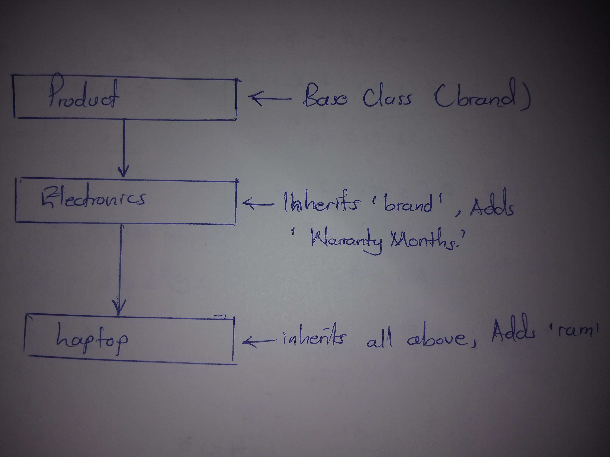

# Assignment Part 1: Chained (Multilevel) Inheritance Practice

This document explains how chained (multilevel) inheritance works in C++ using a real-world tech device scenario.

## 🏗️ Class Relationship Structure
Chained inheritance happens when a class acts as a child to one class but a parent to another. 

1. **Top Layer (Product Base Class):** This is the master template. It holds the most general data member that applies to everything, which is the `brand`.
2. **Middle Layer (Electronics Class):** This class inherits directly from `Product`. Because of the chain, it automatically receives the `brand` property and adds its own specific data member, `warrantyMonths`.
3. **Bottom Layer (Laptop Class):** This is the most specific class in the chain. It inherits from `Electronics`. Because inheritance passes all the way down, a Laptop automatically gets access to both `brand` and `warrantyMonths`, while adding its own unique local property, `ram`.

---

## 🔍 Conceptual Explanations

### 1. Data Access via Protected Members
Instead of using `private` fields in our parent classes, we use `protected`. If the `brand` variable was private inside `Product`, our bottom `Laptop` class would be blocked from reading or printing it directly. Using `protected` keeps the variables safe from outside modification while letting the lower child classes use them freely.

### 2. Constructor Chaining Mechanics
When creating an object at the bottom of the chain (`Laptop`), data cannot be assigned to inherited fields directly. The initialization must move backward up the chain. The `Laptop` constructor passes the brand and warranty details up to the `Electronics` constructor, and the `Electronics` constructor passes the brand up to the master `Product` constructor.

### 3. Combining Inherited and Local Traits
The main goal of this design is to show how a single object can access functions from different levels of its lineage. When a member function is called on the `Laptop` object, it successfully prints data it owns locally (`ram`) alongside data it received from higher layers (`brand` and `warrantyMonths`).
